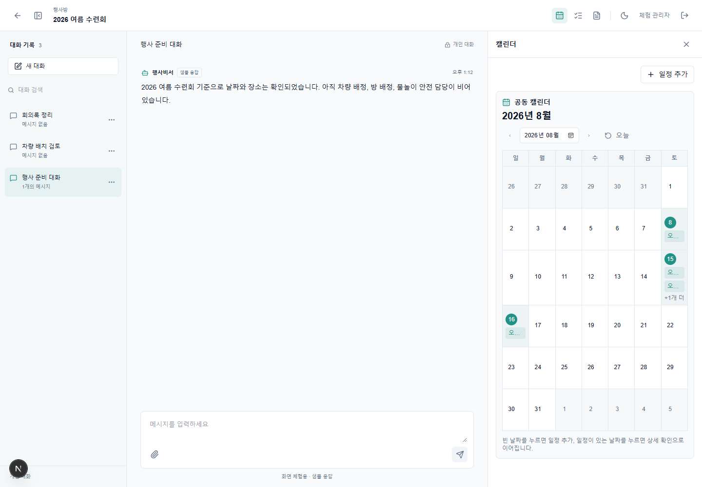
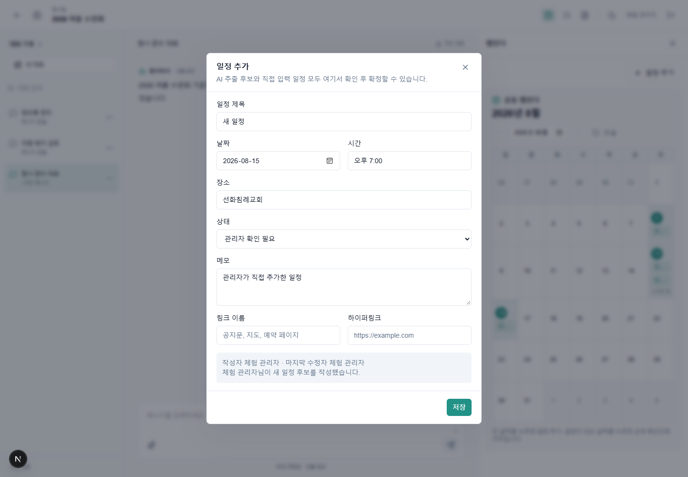
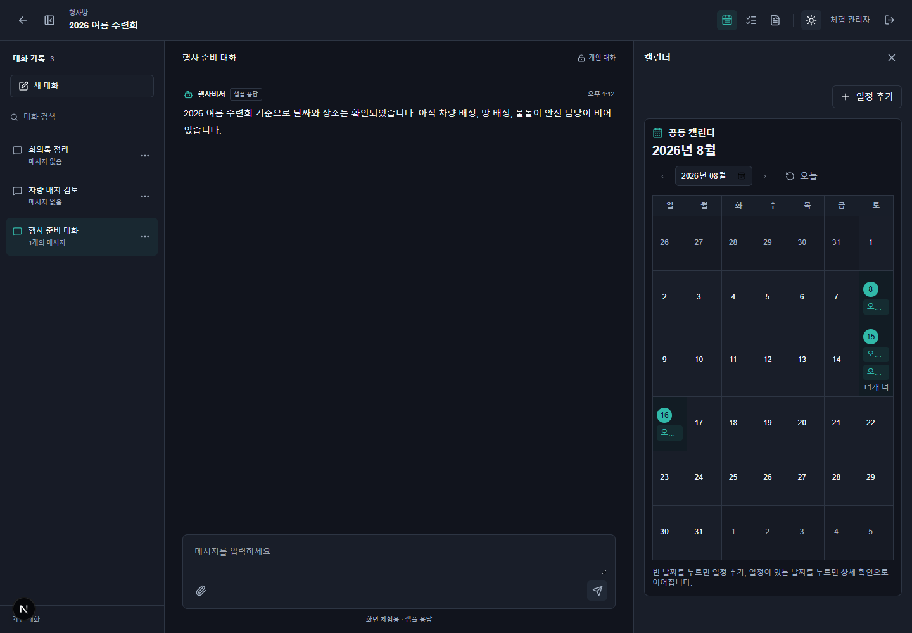

# 행사비서

교회 행사의 준비 시기와 빠진 일을 놓치지 않도록 담당자를 보조하는 웹 서비스입니다.
수련회·예배·절기 행사마다 공간을 나누고, 대화와 일정·준비 상태·자료를 함께 확인하는 경험을 만들고 있습니다.

**현재는 PC 중심의 화면 체험용 프로토타입입니다.** 대화 답변과 행사 자료는 샘플이며 실제 운영 서비스가 아닙니다.
실제 비밀번호, 개인정보, 비공개 문서는 입력하지 마세요.

## 이용 흐름

1. 초대코드로 가입한 뒤 로그인합니다.
2. 카드형 대기실에서 행사방을 선택하거나 새 행사방을 만듭니다.
3. 행사 안에서 주제별 개인 대화를 만들고 기록을 이어갑니다.
4. 캘린더·준비 현황·자료를 필요한 때 열고 닫습니다.

일정과 준비 상태의 변경은 담당자가 확인한 뒤 반영하는 방향으로 기획하고 있습니다.

## 실행 방법

현재 이 저장소에는 소개 문서와 화면 캡처만 공개되어 있습니다.
저장소를 내려받는 것만으로 실행할 수는 없습니다. 아래 명령은 실행 코드를 보유한 로컬 개발 환경용입니다.
Node.js와 pnpm이 필요합니다.

```powershell
pnpm install
pnpm dev --port 3001
```

브라우저에서 `http://127.0.0.1:3001`을 엽니다. 다른 사람의 기기에서 접속할 수 있는 공유 주소는 아닙니다.

## 체험용 코드

| 초대코드 | 체험 범위 |
| --- | --- |
| `CHURCH-STAFF-2026` | 행사방 생성·삭제와 대화·도구 화면 |
| `CHURCH-TEAM-2026` | 기존 행사방 선택·입장과 대화·도구 화면 |

회원가입 화면에서 코드를 확인하고 체험용 이름·아이디·비밀번호를 입력합니다.
가입 후에는 같은 아이디로 로그인합니다. 실제 사용 중인 비밀번호는 사용하지 마세요.

## 화면 미리보기

### 시작과 가입

| 시작 화면 | 회원가입 | 로그인 |
| --- | --- | --- |
|  |  |  |

### 행사방 대기실

행사 종류·일정·준비 상태를 확인하고 검색·필터·정렬로 원하는 방을 찾습니다.


### 행사 안의 작업 화면

왼쪽은 현재 행사의 개인 대화 기록, 가운데는 선택한 대화입니다.
오른쪽 도구와 왼쪽 기록은 각각 접을 수 있습니다. 다른 행사는 대기실에서 선택합니다.



### 일정 입력



### 다크 모드



기능별 기획과 진행 기록은 [Issues](https://github.com/ts825360/newchatbot/issues)에서 확인할 수 있습니다.
