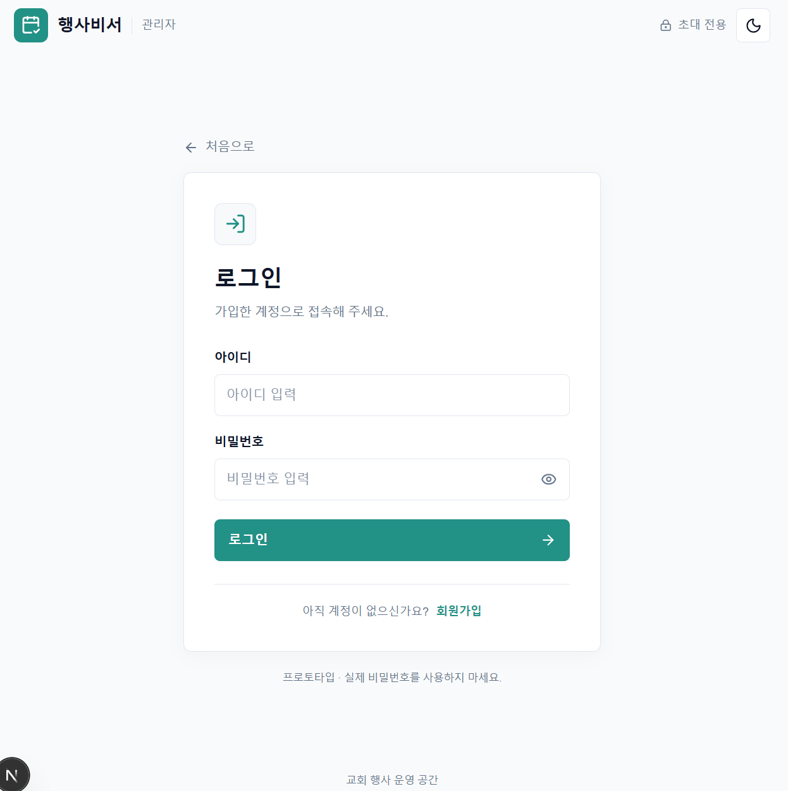
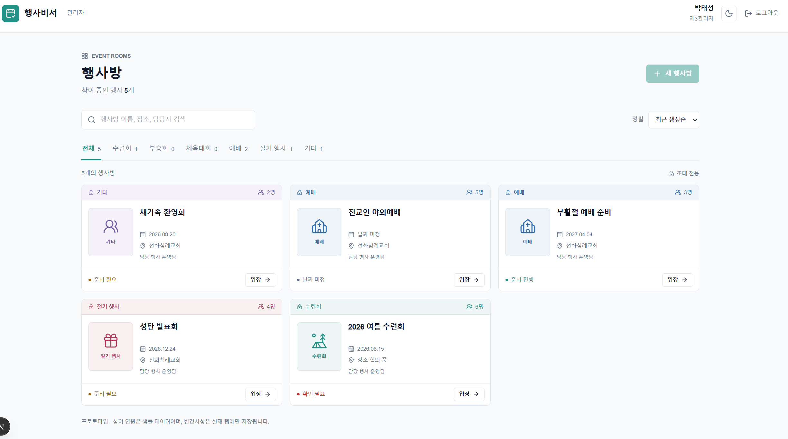
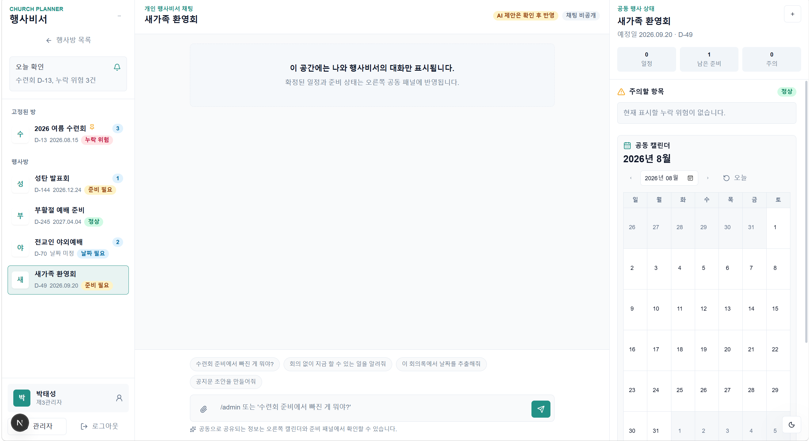
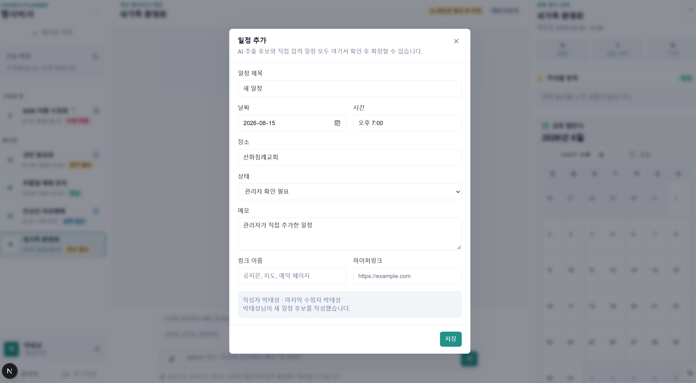
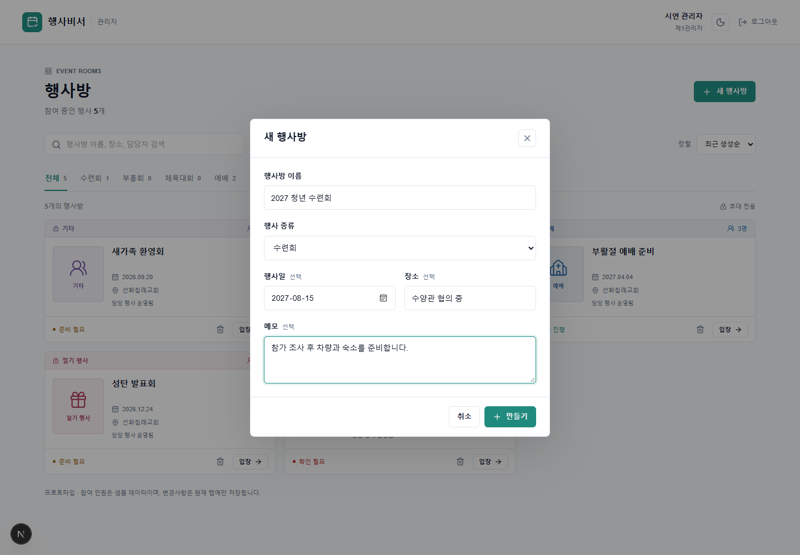
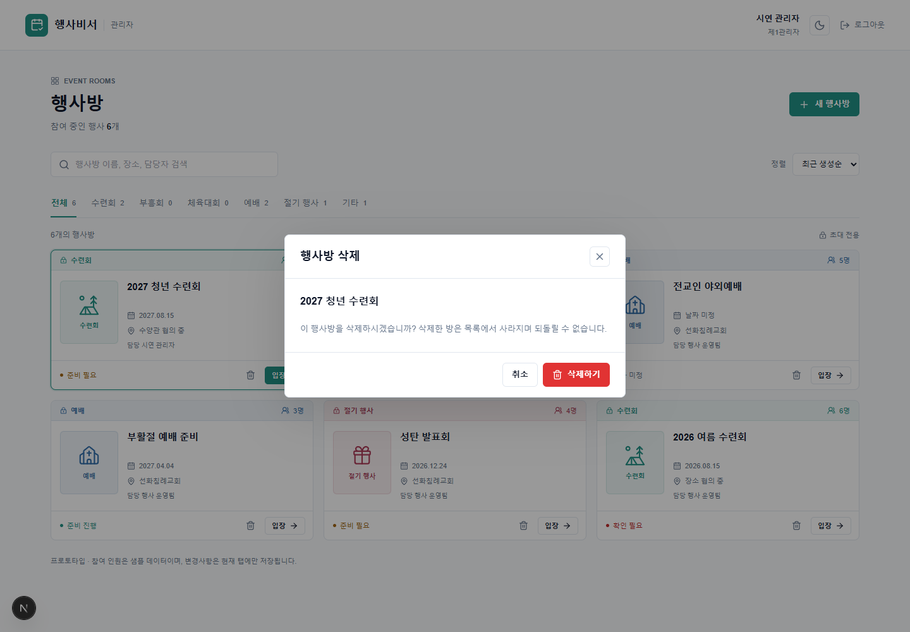

# 행사비서 프론트엔드 프로토타입

교회 행사 준비를 보조하는 서비스의 화면과 사용자 흐름을 검증하는 프로젝트입니다.
AI는 준비 상태와 누락사항을 분석하고 초안을 제시하며, 공유 일정이나 확정 배치의
변경은 담당자가 승인하는 방향으로 기획하고 있습니다.

**현재는 프론트엔드 체험용입니다. 실제 인증·보안 경계가 아니며 실제 비밀번호,
교인 명단, 비공개 문서를 입력하면 안 됩니다.**

## GitHub 공개 범위

현재 GitHub 저장소에는 이 README와 화면 캡처만 게시되어 있습니다.
아래 구현 상태·사용법·검증 기록은 개발자의 로컬 프론트엔드 프로토타입 기준이며,
애플리케이션 실행 코드는 아직 업로드하지 않았습니다. 저장소를 내려받는 것만으로
서비스를 실행할 수 있는 단계는 아닙니다.

## 화면 구현 순서

| 단계 | 목표 | 현재 상태 |
| --- | --- | --- |
| 1 | 로그인·회원가입 선택 → 초대코드 회원가입 → 계정 로그인 | 구현 |
| 2 | 행사방 생성·삭제·선택 및 입장 화면 | 카드형 대기실로 구현 |
| 3 | 채팅기록 \| 채팅 \| 부가기능 패널 작업 화면 | 기존 목업은 있으나 새 기획 반영은 미구현 |

이번 작업은 PC 화면 중심입니다. 모바일 전용 화면과 별도 앱 설계는 후속 작업입니다.
로그인하면 행사방 대기실로 이동하고, 방을 선택해 입장하면 기존 3단 작업 화면이 열립니다.

## 로컬 실행

아래는 실행 코드를 보유한 개발 환경의 실행 방법입니다. 현재 문서·이미지만 있는
GitHub 저장소에서는 사용할 수 없습니다. Node.js와 pnpm이 필요합니다.

```powershell
pnpm install
pnpm dev --port 3001
```

접속 주소: [http://127.0.0.1:3001](http://127.0.0.1:3001)

| 주소 | 화면 |
| --- | --- |
| `/` | 로그인·회원가입 선택. 작업 화면이나 행사 데이터는 표시하지 않음 |
| `/signup` | 초대코드 확인, 이름·아이디·비밀번호·비밀번호 확인 입력 |
| `/login` | 가입한 아이디·비밀번호로 모의 로그인 |
| `/rooms` | 카드형 행사방 대기실. 비로그인 상태에서는 `/login`으로 이동 |
| `/workspace` | 선택한 행사방의 기존 작업 화면. 로그인하지 않으면 `/login`, 입장한 방이 없으면 `/rooms`로 이동 |

## 1단계 체험 방법

1. 첫 화면에서 **회원가입**을 선택합니다.
2. 아래 체험용 초대코드 중 하나를 입력하고 **확인**을 누릅니다.
3. 이름, 아이디, 비밀번호와 비밀번호 확인을 입력해 가입합니다.
4. 로그인 화면으로 이동하면 가입한 아이디가 채워지고 가입 완료 메시지가 표시됩니다.
5. 가입한 비밀번호로 로그인하여 행사방 대기실로 이동합니다.
6. 카드에서 **입장**을 누르면 해당 방의 기존 작업 화면이 열립니다.
7. 작업 화면 왼쪽 위 **행사방 목록**으로 대기실에 돌아오거나 **로그아웃**으로 나올 수 있습니다.

| 체험용 초대코드 | 등급 | 모의 계정 만료 |
| --- | --- | --- |
| `CHURCH-OWNER-2026` | 제1관리자 | 정기 만료 없음 |
| `CHURCH-STAFF-2026` | 제2관리자 | 정기 만료 없음 |
| `CHURCH-TEAM-2026` | 제3관리자 | 가입 시점 다음 12월 1일 00:00 한국시간 |

각 코드는 현재 탭에서 1회 가입용입니다. 코드의 등급은 사용자가 선택할 수 없습니다.
제1·2관리자는 기존 관리자 목업에도 접근하며, 제3관리자는 기본 행사 준비 권한으로
체험합니다. 세부 강퇴·권한 관리와 실제 초대키 발급은 아직 구현하지 않았습니다.
기존 관리자 목업에서 생성하는 초대키는 새 가입 화면과 연결되지 않았습니다.

아이디는 영문·숫자·밑줄·하이픈 4~24자이며 대소문자를 구별하지 않습니다.
이름은 1~20자, 체험 비밀번호는 8~72자입니다.
초대코드 오류·사용 완료, 아이디 중복, 비밀번호 불일치, 잘못된 로그인,
모의 계정 만료와 브라우저 저장 실패를 처리합니다. 저장 실패로 로그아웃하지 못하면
아직 로그인된 상태임을 안내하고 재시도할 수 있습니다. 비밀번호 표시 전환과
라이트·다크 모드 전환도 지원합니다.

## 2단계: 행사방 대기실

게임의 방 선택 목록처럼 행사방 카드를 여러 열로 나열하되, 기존 행사비서의
색상과 업무용 디자인을 유지했습니다. 게임 이미지나 장식은 서비스 화면에 사용하지 않습니다.

- 카드에 행사 종류, 행사방 이름, 날짜, 장소, 담당 팀, 샘플 참여 인원과 준비 상태를 표시합니다.
- 카드를 누르면 선택 표시가 바뀌고 **입장**으로 해당 행사방을 엽니다.
- 종류별 탭, 이름·장소·담당자 검색, 최근 생성순·날짜순·이름순 정렬을 제공합니다.
- **새 행사방**에서 이름과 종류를 지정합니다. 행사일·장소·메모는 선택 입력입니다.
  날짜를 입력하지 않으면 **날짜 미정**으로 표시하며, 생성 후 새 카드를 선택 표시합니다.
- 휴지통 버튼은 삭제 확인창을 엽니다. 취소 또는 Esc로 돌아갈 수 있습니다.
  삭제한 방은 새로고침해도 복구되지 않으며, 전체 삭제 시 빈 목록을 유지합니다.
- 현재 목업 권한은 제1·2관리자에게 생성·삭제를, 제3관리자에게 선택·입장을 허용합니다.
  생성·삭제까지 체험하려면 `CHURCH-OWNER-2026` 또는 `CHURCH-STAFF-2026`으로 가입합니다.
- 캘린더·채팅 화면은 기존 목업을 연결한 상태이며 3단계 개편은 별도 작업입니다.

방 목록·입장한 방은 계정 ID별 `sessionStorage`에 저장됩니다. 같은 이름의 계정도
목록이 섞이지 않으며, 다른 계정이나 다른 관리자의 화면에 공유되지는 않습니다.
인원 수는 온라인 접속자 수가 아닌 샘플 담당 인원입니다. 실제 방 초대·실시간 동기화·
다른 사용자의 접근 철회·서버 권한 검사는 아직 구현하지 않았습니다.
삭제는 현재 탭의 해당 계정 목록에만 반영되며 실제 공동 데이터 삭제가 아닙니다.

## 모의 인증의 한계

- 계정·사용한 초대코드·모의 로그인 상태는 `sessionStorage`에 저장됩니다.
  같은 탭에서는 새로고침과 로그아웃 후 재로그인이 가능합니다. 탭을 닫으면
  일반적으로 사라지지만 브라우저의 탭 복원으로 복구될 수 있습니다.
  새 탭이 기존 탭의 저장소를 복사해 시작하는 경우도 있으므로 탭 종료를 보안 기능으로
  취급하지 않습니다. 다른 기기·브라우저와 계정이 동기화되지는 않습니다.
- 비밀번호 평문은 저장하지 않습니다. 탭 안에서 비교하기 위한 솔트와 SHA-256
  다이제스트를 사용하지만, **이는 실제 비밀번호 저장 방식이나 보안 인증의 구현이
  아닙니다.** 클라이언트 코드와 저장값은 사용자가 변경할 수 있습니다.
- 초대코드는 소스에 공개된 시연용 값입니다. 실제 난수 초대키 발급·해시 검증,
  서버 세션·권한 검사·시도 횟수 제한·계정 복구·탈퇴·강퇴는 미구현입니다.
- 제3관리자 만료는 브라우저 시간으로 모의 검사합니다. 운영 환경의 서버 기준 만료,
  세션 일괄 폐기와 계정 관리가 구현된 것은 아닙니다.
- 로그아웃은 모의 로그인 상태만 제거하며 가입 계정과 코드 사용 기록은 유지합니다.
- 생성한 계정으로 다른 PC나 휴대폰에서 로그인하는 기능은 실제 백엔드 구현 때 추가합니다.
- 기존 채팅 답변·행사·캘린더는 샘플 상태이며 실제 LLM, DB, Google Forms·Calendar와
  연동하지 않습니다. 기존 작업 화면의 편집 내용도 영구 저장되지 않습니다.

체험 계정과 코드 사용 기록을 초기화하려면 현재 사이트의 브라우저 콘솔에서 실행합니다.

```javascript
sessionStorage.removeItem("church-planner-demo-auth-v1");
location.assign("/");
```

## 검증

```powershell
pnpm test --run
pnpm exec tsc --noEmit
pnpm build
```

- `tests/prototype-auth.test.ts`: 가입, 코드 사용, 중복 아이디, 비밀번호 검증,
  재로그인, 로그아웃, 등급별 만료와 저장소 오류.
- `tests/auth-screen.test.tsx`: 화면 진입, 입력 오류, 코드 확인, 가입 후 로그인 연결,
  비밀번호 표시와 테마 전환.
- `tests/prototype-app-auth.test.tsx`: 로그아웃 저장 실패 안내와 재시도.
- `tests/room-catalog.test.ts`: 방 생성·선택·삭제·저장·계정별 분리·검색과 입력 검증.
- `tests/room-lobby.test.tsx`: 종류 필터, 빈 결과, 방 생성·삭제 취소·입장과 등급별 화면.
- 기존 행사 상태·캘린더 테스트를 함께 실행합니다.

### 1단계 검증 기록: 2026-11-16

- 단위·화면 테스트 총 29개 통과, TypeScript 검사와 Next.js 프로덕션 빌드 통과.
- Windows Edge의 Playwright 브라우저 검사로 가입 오류·가입 완료·로그인 실패·성공,
  새로고침 후 접속 유지, 로그아웃, 로그아웃 후 작업 화면 접근 시 로그인 이동,
  재로그인, 코드 재사용 거절과 다크 모드 유지를 확인했습니다.
- PC 1280×720, 1440×1000, 1920×1080에서 확인했습니다. 1280·1920 너비의
  세 인증 화면에 가로 넘침이 없고 입력란이 화면 너비 안에 들어오는 것을 확인했습니다.
  브라우저 실행 오류는 관찰되지 않았습니다. 모바일·실제 서버 인증 검증은 아닙니다.

### 2단계 검증 기록: 2026-11-16

- 기존 테스트를 포함한 총 47개 테스트, TypeScript 검사와 프로덕션 빌드를 통과했습니다.
- Windows Edge의 Playwright 검사로 로그인 → 대기실 이동, 종류·검색 필터,
  생성 입력 검증, 생성 후 새로고침, 새 방 입장과 목록 복귀, 삭제 취소·확정,
  삭제 후 새로고침, Esc 닫기, 로그아웃 후 접근 제한을 확인했습니다.
- 제3관리자에게 생성 버튼이 비활성화되고 삭제 버튼이 표시되지 않는 것을 확인했습니다.
- 창 포커스를 다시 받았을 때 방 고정이 되돌아가는 회귀를 수정했습니다.
  고정·순서·읽지 않은 변경 수를 모의 목록에 저장하며 관련 테스트를 추가했습니다.
- PC 1280×720, 1440×1000, 1920×1080에서 가로 넘침이 없고 카드 높이가
  일정함을 확인했습니다. 라이트·다크 화면을 캡처했고 브라우저 실행 오류는 없었습니다.
  모바일, 기기 간 공유, 실제 인증·실시간 협업을 검증한 것은 아닙니다.

### 화면 캡처

아래는 사용자가 제공한 1단계 화면 캡처입니다.

| 로그인·회원가입 선택 | 회원가입 | 로그인 |
| --- | --- | --- |
|  |  |  |

아래 링크는 추가 검증 과정에서 저장한 화면입니다.

| 화면 | 캡처 |
| --- | --- |
| 로그인·회원가입 선택 | [진입 화면](docs/prototypes/screenshots/01-auth-entry.png) |
| 초대코드 회원가입 | [회원가입 화면](docs/prototypes/screenshots/02-auth-signup.png) |
| 가입 완료 후 로그인 | [로그인 화면](docs/prototypes/screenshots/03-auth-login.png) |
| 다크 모드 | [다크 모드 로그인](docs/prototypes/screenshots/04-auth-login-dark.png) |

### 2단계 화면

사용자가 제공한 행사방 대기실과 입장 후 화면 캡처입니다.

#### 행사방 대기실

제3관리자로 접속한 화면입니다. 행사방 생성은 비활성화되고 선택·입장은 가능합니다.



#### 행사방 입장 후 기존 작업 화면

왼쪽 행사방 목록, 가운데 개인 채팅, 오른쪽 공동 캘린더·준비 상태를 보여주는 기존 목업입니다.
3단계의 새로운 채팅기록·채팅·부가기능 화면 개편이 완료된 것은 아닙니다.



#### 기존 일정 추가 목업

일정 제목·날짜·시간·장소·상태·메모·링크를 입력하는 기존 일정 추가창입니다.
실제 AI 일정 추출이나 Google Calendar 연동을 구현한 화면은 아닙니다.



#### 추가 검증 캡처

[제1관리자의 행사방 대기실](docs/prototypes/screenshots/05-room-lobby.png)

| 새 행사방 만들기 | 행사방 삭제 확인 |
| --- | --- |
|  |  |

[다크 모드 행사방 대기실](docs/prototypes/screenshots/08-room-lobby-dark.png)

## 주요 파일

| 파일 | 역할 |
| --- | --- |
| `components/auth-screen.tsx` | 진입·회원가입·로그인 UI |
| `lib/prototype-auth.ts` | 교체 가능한 브라우저 전용 모의 계정 처리 |
| `lib/use-theme.ts` | 인증 화면과 기존 작업 화면의 테마 공유 |
| `components/room-lobby.tsx` | 행사방 대기실·검색·필터·생성·삭제 UI |
| `components/room-dialog.tsx` | 키보드 포커스가 유지되는 네이티브 확인·입력 대화상자 |
| `lib/room-catalog.ts` | 계정별 모의 행사방 목록과 선택 상태 저장 |
| `app/rooms/rooms.css` | 대기실·카드·대화상자 스타일 |
| `app/prototype-app.tsx` | 기존 작업 화면과 모의 세션 연결 |
| `app/globals.css` | 기존 공통 스타일과 인증 화면 전용 스타일 |

향후 실제 인증을 구현할 때는 모의 어댑터를 서버 API로 교체하고, 비로그인 사용자의
데이터 API·파일 접근을 서버에서 거부해야 합니다. 화면 이동 제한만으로 보안이
구현되었다고 판단하지 않습니다.
