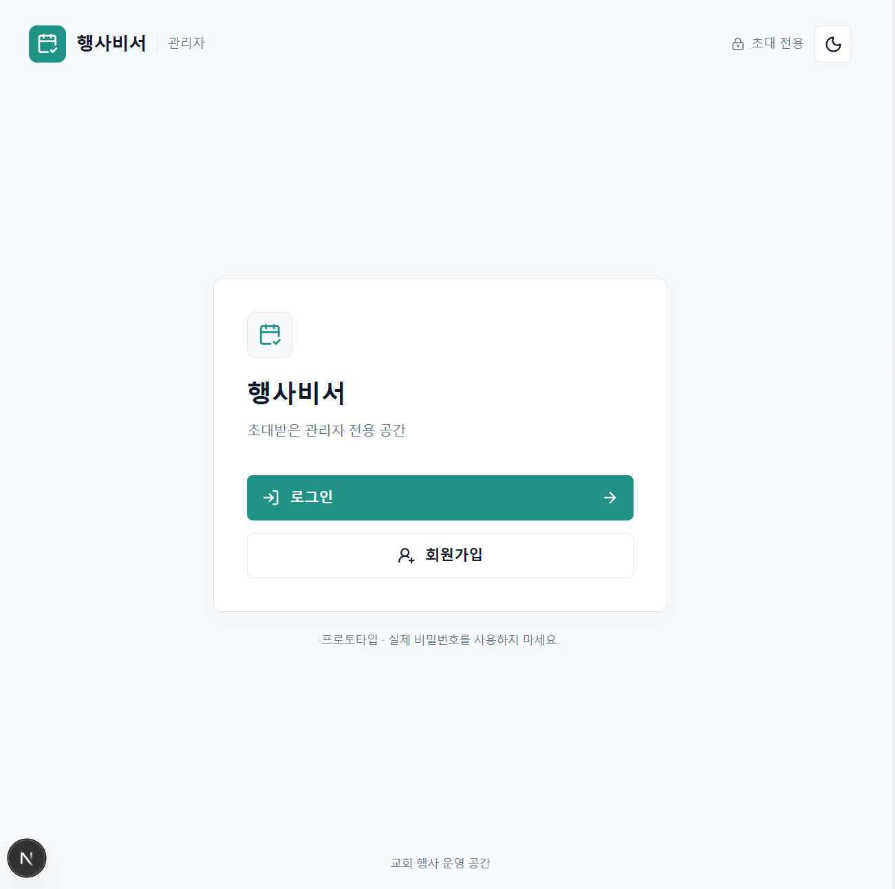
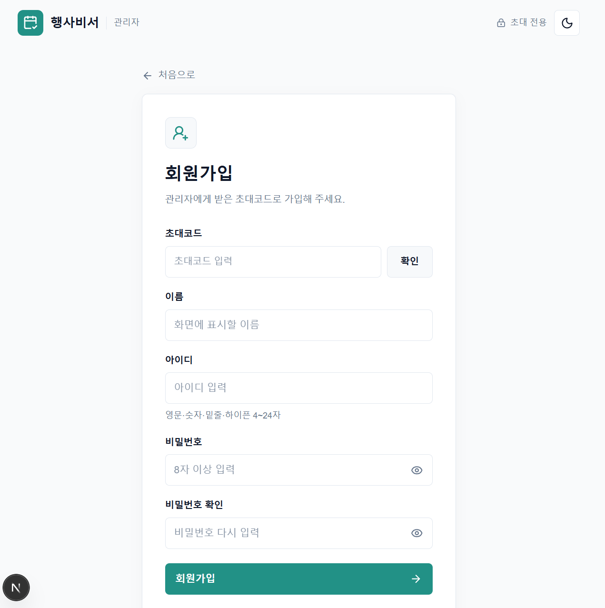

# 행사비서

교회 행사의 준비 시기와 빠진 일을 놓치지 않도록 담당자를 보조하는 웹 서비스입니다.
수련회·예배·절기 행사마다 공간을 나누고, 대화와 일정·준비 상태·자료를 함께 확인하는 경험을 만들고 있습니다.

**개발 버전입니다.** 행사방, 일정, 준비 현황, 차량·숙소 배정, 문제 신고를 로컬 서버에서 실행할 수 있습니다.
서비스 운영 데이터와 외부 연동 키는 공개 저장소에 포함되지 않습니다.

## 코드 검토 시작점

ChatGPT나 다른 개발 도구에서 최신 개발 소스를 검토할 때는 기본 브랜치 `main`을 선택하세요. 현재 버전은 [`package.json`](package.json), 변경 내역은 [변경 이력](CHANGELOG.md)에서 확인할 수 있습니다. 특정 배포판을 재현할 때는 해당 버전 태그를 사용하세요.

| 찾는 내용 | 경로 |
| --- | --- |
| AI 판단 원칙, 현재 연결 범위, 다음 개선 작업 | [AI 개선 로드맵](docs/assistant-improvement-roadmap.md) |
| 구현·검토할 때 유지할 프로젝트 규칙 | [AGENTS.md](AGENTS.md) |
| AI 요청 처리, 도구 조회 및 응답 형식 | [채팅 서버](lib/server/chat.ts), [공통 프롬프트](lib/server/chat-advisor-prompt.ts), [응답 스키마](lib/chat-advisor.ts) |
| 채팅 UI와 제안 승인 | [채팅 화면](components/chat-panel.tsx), [승인 카드](components/chat-work-card.tsx), [제안 반영](lib/proposal-application.ts) |
| 회귀 테스트와 가상 질문 평가 | [테스트](tests), [이전 파일럿 평가](docs/assistant-pilot-evaluation.md) |
| 릴리스와 Docker 운영 예시 | [릴리스 절차](docs/releases.md), [Docker 운영 안내](docs/docker-nas-operations.md) |

## 이용 흐름

1. 초대코드로 가입한 뒤 로그인합니다.
2. 카드형 대기실에서 행사방을 선택하거나 새 행사방을 만듭니다.
3. 행사 안에서 주제별 개인 대화를 만들고 기록을 이어갑니다.
4. 캘린더·준비 현황·자료를 필요한 때 열고 닫습니다.

변경 제안은 담당자가 검토하고 반영합니다. 차량 배정에는 계산 결과와 별도의 담당자 승인 단계가 있습니다.

## 실행 방법

Node.js 24 이상과 pnpm이 필요합니다. 처음 실행할 때는 프로젝트 루트에서 로컬 관리자 계정을 만듭니다.

```powershell
pnpm install --frozen-lockfile
pnpm setup:owner
pnpm dev --port 3001
```

브라우저에서 `http://127.0.0.1:3001`을 열고 준비한 계정으로 로그인합니다.
이 주소는 현재 기기에서만 접근할 수 있습니다. 개발 서버를 외부에 공개하지 마세요.

다른 사용자의 계정은 관리자가 발급한 초대코드로 가입합니다. 테스트에는 실제 명단이나 다른 곳에서 쓰는 비밀번호 대신 가상 데이터를 사용하세요.

앱 테스트는 `pnpm exec vitest run tests/`로 실행합니다. 차량 계산에는 `requirements-transport.txt`의 Python 의존성이 필요하며, Docker 빌드에는 이 의존성이 포함됩니다. Google 연동, AI 답변, 문제 신고 메일은 별도의 설정이 필요한 선택 기능입니다.

## 화면 미리보기

아래 이미지는 초기 화면의 예시이며 현재 버전과 다를 수 있습니다.

### 시작과 가입

| 시작 화면 | 회원가입 | 로그인 |
| --- | --- | --- |
|  |  |  |

### 행사방 대기실

행사 종류·일정·준비 상태를 확인하고 검색·필터·정렬로 원하는 방을 찾습니다.


### 행사 안의 작업 화면

왼쪽은 현재 행사의 개인 대화 기록, 가운데는 선택한 대화입니다.
오른쪽 도구와 왼쪽 기록은 각각 접을 수 있습니다. 다른 행사는 대기실에서 선택합니다.


### 일정 입력


### 다크 모드


기능별 기획과 진행 기록은 [Issues](https://github.com/ts825360/newchatbot/issues)에서 확인할 수 있습니다.
