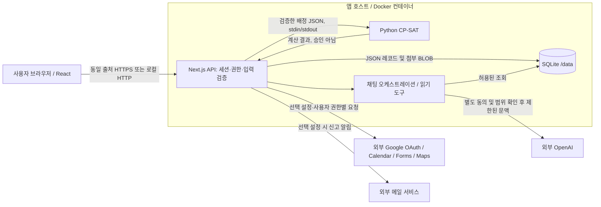

# 행사비서 개발 인수인계: 0.2.0-rc.25

## 시작 지점

이 문서는 공개 저장소의 `codex/handoff-rc25` 개발 기준선을 설명한다. 여기서 검토할 코드의 버전은 [`package.json`](../package.json)과 현재 커밋 SHA로 식별한다. 시작 시점의 GitHub `main`은 `7873305`(rc.14), 현재 작업의 부모는 `7775593`(rc.15)였다. `main`과 기존 PR은 이 인수인계 때문에 병합하거나 갱신하지 않는다. 로컬 Docker의 rc.25 이미지에는 직전 작업까지의 실행 코드가 들어 있으며, 이번 공개본의 연락처 설정과 문서까지 반영한 이미지로 교체하지 않았다. 버전 문자열이 같아도 이미지와 공개 커밋이 바이트 단위로 동일하다고 가정하지 않는다.

1. [프로젝트 규칙](../AGENTS.md), [요구사항 추적표](requirements/traceability.md), [#35 통합 이슈](https://github.com/ts825360/newchatbot/issues/35)를 읽는다.
2. [AI 실행과 프롬프트 기준선](handoff/ai-baseline.md), [설문·배정·자료의 현재 계약](handoff/event-operations.md), [#35~#43 순서와 완료 기준](handoff/issue-roadmap.md)을 대조한다.
3. 다음 수정 브랜치는 이 기준선에서 분기하고 SHA·모델·평가 입력을 고정한다. 프롬프트를 수정하거나 실험 도구를 도입하기 전에 코드 감사와 [#40](https://github.com/ts825360/newchatbot/issues/40) 기준선 평가부터 진행한다. 아래 자동 테스트 결과는 실 모델 품질 기준선이 아니다.

별도 `chatgpt/*` 브랜치 두 개는 원격에서 확인한 GitHub 연결 확인용 문서 브랜치다. 과거 `codex/chat-approval-cards`의 로컬 문서 커밋 `e6f0147`은 이 브랜치에 체리픽하지 않았다. 해당 파일들의 현재판은 새 기준선에서 추적되며, 과거 브랜치와 커밋도 삭제하지 않았다.

## 구조와 데이터 경계

Next.js App Router, React/TypeScript, CSS/Tailwind, `node:sqlite`, Python OR-Tools CP-SAT로 구성된다. npm 의존성은 `pnpm-lock.yaml`, Python은 [`requirements-transport.txt`](../requirements-transport.txt)로 관리한다. 브라우저는 상대 경로의 Next.js Route Handler와 통신한다. 별도 Python HTTP 서비스는 없다.



| 경로 | 책임 및 시작 함수 |
| --- | --- |
| [`app/prototype-app.tsx`](../app/prototype-app.tsx), [`components/event-workspace.tsx`](../components/event-workspace.tsx) | 로그인 뒤 앱 상태 연결, 행사방 셸, 대화/작업 패널, 승인·직접 편집 연결. |
| [`lib/backend-client.ts`](../lib/backend-client.ts), [`app/api/data/route.ts`](../app/api/data/route.ts) | `dataStorage`, `refreshBackendData`, `flushBackendWrites`, `writeConfirmedBackendRecord`. 서버 JSON과 `revision` 기준 동시 편집 확인. 실패한 초안을 성공으로 표시하지 않는다. |
| [`lib/server/records.ts`](../lib/server/records.ts), [`lib/server/record-schema.ts`](../lib/server/record-schema.ts), [`lib/server/conversation-scope.ts`](../lib/server/conversation-scope.ts) | `locateRecord`, `readSnapshot`, `writeBatch`, `validateRecord`, `requireOwnedConversation`. 계정/행사/대화 범위를 서버에서 소유권과 대조한다. |
| [`lib/server/database.ts`](../lib/server/database.ts) | `createDatabase`, `getDatabase`, `transaction`, `bumpRevision`. WAL, FK, SQL strict table, `BEGIN IMMEDIATE` 기반 쓰기. 로컬 기본 경로는 `.local/server`, 컨테이너는 `/data`. |
| [`app/api/transport/route.ts`](../app/api/transport/route.ts), [`scripts/transport_solver.py`](../scripts/transport_solver.py) | 검증된 입력을 지정된 Python 실행 파일의 표준 입력으로 전달하고 결과·버전을 검증한다. 결과 변경과 확정은 별도이며 모델이나 Python에 임의 명령 실행을 위임하지 않는다. |

**SQLite:** `users`, `invitations`, `sessions`, `rate_limits`, `activities`가 인증/감사를, `rooms`와 `room_visits`가 행사방/방문 기록을 관리한다. `records`는 범위가 포함된 키·`owner_id`·`room_id`·JSON·revision을 사용한다. 공동 캘린더는 `owner_id`가 없고, 대화 문서·장소·준비·차량/숙소 작업은 개인 범위를 공유 자료와 구분한다. 여러 대화가 같은 계정/행사 준비 기록을 재사용하는 종류와 대화 자체에 귀속되는 종류는 `canonicalWorkspaceTool` 및 `canonicalPrivateTool`을 함께 확인한다. `conversation_files`는 개인 첨부이고 `files`의 기존 방 단위 경로와 구분된다. `chat_work_versions`는 공통 AI 작업 전체가 아니라 현재 설문 작업 버전의 저장 근거다. `user_notifications`, `daily_devotions`, `issue_reports`는 별도 테이블이며, Google 연결 및 전송은 `google_*` 계열 테이블에 분리된다.

**스키마 적용:** 별도 순번 마이그레이션 프레임워크는 없다. 초기화 시 `CREATE TABLE/INDEX IF NOT EXISTS`를 실행한다. 이번 [검사](../scripts/check-schema-upgrade.mjs)는 원격 `main`의 rc.14 DDL로 만든 합성 DB에서 `chat_work_versions`·`user_notifications`가 생기고 기존 레코드·외래키가 유지되는지, 두 번 시작해도 같은지 확인한다. 운영 SQLite나 파일을 첨부하지 않는다. 향후 컬럼 변경 또는 외래키·백필 작업에는 번호가 있는 마이그레이션과 백업 복구 시험을 추가한다. 개발 핫리로드의 기존 연결 확인 목록에는 `user_notifications`가 없어 해당 테이블이 필요한 변경을 적용할 때 개발 서버 재시작이 필요할 수 있다.

## 기능 상태와 파일

`격리 검증`은 합성 브라우저/서버 또는 회귀 테스트로 확인했다는 뜻이다. 실계정·실제 행사·NAS 검증을 뜻하지 않는다. 세부 조건과 테스트 이름은 연결된 문서에서 확인한다.

| 기능 | 현재 상태 및 확인 지점 |
| --- | --- |
| 로그인·가입·운영 관리 | **격리 검증/자동 테스트.** `/api/auth/[action]` → [`authGet`/`authPost`](../lib/server/auth.ts). 초대 기반 가입과 세션, 제1·2관리자 초대 발급, 계정 변경·일시 정지. 실제 권한은 `requirePermission`. [`server-auth.test.ts`](../tests/server-auth.test.ts), [`auth-screen.test.tsx`](../tests/auth-screen.test.tsx). |
| 행사방 목록·담당자·방 구성원 | **격리 검증/자동 테스트.** [`room-lobby.tsx`](../components/room-lobby.tsx), `readCatalog`, `saveCatalog`. 담당자 계정 ID로 최신 표시명 조회, 사용자별 즐겨찾기, 상태 필터. `room_visits`에서 유효한 접근자만 집계하며 실제 참가자 명단이 아니다. [`room-lobby.test.tsx`](../tests/room-lobby.test.tsx), [`server-records.test.ts`](../tests/server-records.test.ts). |
| 개인 대화·공통 UI | **격리 검증.** [`conversation-store.ts`](../lib/conversation-store.ts), [`chat-panel.tsx`](../components/chat-panel.tsx), [`workspace-tool-navigation.tsx`](../components/workspace-tool-navigation.tsx). 4차의 고정 상단 메뉴, 패널 열기/닫기/폭 변경, 초안·탭·필터 보존. 권한 범위가 달라지면 이전 대화의 상태는 재사용하지 않는다. |
| 내 계정·접근성·알림·답변 스타일·보안·도움말 | **격리 검증/자동 테스트.** [`settings-screen.tsx`](../components/settings-screen.tsx), [`assistant-preferences.ts`](../lib/server/assistant-preferences.ts), [`notifications.ts`](../lib/server/notifications.ts). `/api/preferences`, `/api/notifications`. 서버가 받는 설정과 화면 전용 설정은 구분한다. 공개 문의 이메일은 선택 설정, 실제 알림 메일은 별도 서버 설정. |
| 공동 캘린더·Google Calendar | **공동 데이터와 권한 자동 테스트, 실제 외부 검증 필요.** [`shared-panel.tsx`](../components/shared-panel.tsx), `/api/data`, [`google-calendar.ts`](../lib/server/google-calendar.ts), [`google-export.ts`](../lib/server/google-export.ts). 앱에서 확정한 일정의 외부 전송 중심이며 양방향 동기화로 설명하지 않는다. `google-calendar.test.ts`, `google-export.test.ts`. |
| 타임테이블 | **격리 검증/자동 테스트.** [`workspace-timetable.tsx`](../components/workspace-timetable.tsx), [`timetable.ts`](../lib/timetable.ts). 일차/시간 블록, 제안 승인 및 저장. 타임테이블을 별도 승인 없이 공동 캘린더로 보내지 않는다. [`timetable.test.ts`](../tests/timetable.test.ts), [`chat-timetable-proposal.test.ts`](../tests/chat-timetable-proposal.test.ts). |
| 준비 현황·중간점검·체크리스트 | **격리 검증 및 부분 구현.** [`workspace-preparation-records.tsx`](../components/workspace-preparation-records.tsx), [`preparation-status.ts`](../lib/server/preparation-status.ts), [`preparation-progress.ts`](../lib/server/preparation-progress.ts). `/api/preparation-progress`, `/api/preparation-surveys`. 진행도는 체크리스트 단순 합계가 아니며, 현재 근거와 미확인을 구분한다. 실제 모델 점검 품질 미평가. |
| 제안 검토·승인 | **격리 검증/자동 테스트.** [`proposal-panel.tsx`](../components/proposal-panel.tsx), [`chat-work-card.tsx`](../components/chat-work-card.tsx), [`proposal-application.ts`](../lib/proposal-application.ts). 읽기/초안/승인 적용을 분리한다. 승인·검증 조건은 종류별로 확인하며 모델 답변을 쓰기 권한으로 해석하지 않는다. |
| 장소·Maps/Places | **저장 격리 검증, 외부 연동은 모의 검증.** [`conversation-location.tsx`](../components/conversation-location.tsx), [`workspace-primary-place.ts`](../lib/server/workspace-primary-place.ts), [`google-maps-request.ts`](../lib/server/google-maps-request.ts). `/api/integrations/google-maps`. 대표 장소와 검색 후보, 주소·개인 메모를 구분한다. 실 Maps·경로·사진 검증은 별도. |
| 설문·Forms·참가자·가족 ID | **부분 구현.** 공통 설문 v2, 출결·출발/귀가 분기, 미게시 원격 생성, CSV/Forms 모의 수집. 교회 원본 명단의 가족 ID 자동 연계와 동명이인의 최종 식별은 미구현. [세부 인수인계](handoff/event-operations.md#설문과-google-forms). |
| 차량 배정 | **핵심 격리 검증, 일부 운영 요구 후속.** 이동 조건·차량·참가자·배치·비교 탭, 방향별 정원 및 운영진 확정, 보존 이력과 CSV. [`transport-panel.tsx`](../components/transport-panel.tsx), [`transport-versions.ts`](../lib/transport-versions.ts), Python solver. 도로 이동 가능성 실측이나 복합 행사 자동 최적화는 하지 않는다. |
| 숙소 배정 | **부분 구현/자동 테스트.** [`transport-lodging.tsx`](../components/transport-lodging.tsx), [`lodging-plan.ts`](../lib/lodging-plan.ts). 기본 수요·확보 방·수동 배정·고정 및 미배정. 비용/추가 침구·독립 버전 비교·차량 수준 확정 이력 등은 [요구사항과 대조](handoff/event-operations.md). |
| 자료·문서·과거 기록 | **개인 첨부 구현, 공동 자료/지식·표준 산출물은 부분 또는 미구현.** [`documents-panel.tsx`](../components/documents-panel.tsx), [`files.ts`](../lib/server/files.ts), `/api/files/[roomId]/[documentId]`. 제한된 미리보기·로컬 추출과 수련회 장소 참고 분석은 별개다. 모든 파일의 본문 검색, 승인된 공동 게시, 보편적 DOCX/HWP 표준 생성, 행사 종료 종합 이력·다음 행사 자동 활용을 제공한다고 가정하지 않는다. |
| 오늘의 묵상·문제 신고 | **자동 테스트/일부 외부 검증 필요.** `/api/devotions`, `/api/reports`, `daily_devotions`, `issue_reports`. [성경 출처 점검](bible-source-audit.md), [`issue-reports.test.ts`](../tests/issue-reports.test.ts). 실제 메일 발송·NAS 운영 및 신규 성경 저작물 도입은 별개다. |

## 보안·운영 검토의 출발점

- 세션 쿠키에서 서버 세션을 찾고 DB에는 토큰 해시를 기록한다. 암호는 PBKDF2-SHA256과 사용자별 salt를 사용한다. 같은 출처, 본문 크기, 활성 계정·권한·대화 소유권을 서버 핸들러에서 확인한다. 검토 시작: [`auth.ts`](../lib/server/auth.ts), [`password.ts`](../lib/server/password.ts), [`http.ts`](../lib/server/http.ts), [`records.ts`](../lib/server/records.ts).
- 현재 행사 접근 모델의 `viewRoom`은 서비스 권한이다. 방문자 집계 테이블은 행사별 구성원 ACL이 아니다. #37 공동 자료 설계에서 기존 개인 자료를 공개로 바꾸거나, 방문 이력을 게시 권한으로 사용하지 않는다. 권한 없는 사용자의 403과 다른 계정·대화 비노출을 [`server-records.test.ts`](../tests/server-records.test.ts)와 파일/채팅 API 테스트로 확인한다.
- 개인정보는 모델 입력/도구 출력/외부 검색/응답에 걸쳐 제한한다. 동의했다고 명단·가족·연락처·파일 원문을 보낼 수 있는 것은 아니다. 패턴 기반 탐지는 자유 문장의 모든 개인정보·인젝션을 판정하지 못하며, 읽기 도구 허용 목록·검증·승인 분리가 핵심이다. 정확한 제한과 미검증 사례는 [AI 기준선](handoff/ai-baseline.md)에 기록했다.
- OAuth 연결은 서버 저장과 설정으로 처리한다. 운영 Google 계정 승인 전 Calendar 전송 경로를 먼저 확인하고, 검증은 키 없는 기본 구동과 합성 자료/전용 테스트 계정으로 분리한다. 로그/캡처와 `.env*`, 운영 SQLite·백업은 공유하지 않는다. [`config/local.env.example`](../config/local.env.example)는 비밀값이 없는 예시이며, `NEXT_PUBLIC_SUPPORT_EMAIL`은 빌드가 브라우저에 공개하는 주소다. 개인 메일은 사용하지 않는다.
- `GET /api/data`가 반환하는 레코드와 서버 `revision` 계약을 유지한다. `records` 행은 DB 스키마가 유효해도 JSON 필드가 유효하다는 뜻이 아니다. 외부 키, TLS, 프록시, 백업/복구는 [Docker 운영 안내](docker-nas-operations.md)를 따른다. 이 인수인계는 실제 NAS 설치 또는 권한 감사를 끝냈다는 뜻이 아니다.

## 로컬 재현 명령

```powershell
pnpm install --frozen-lockfile
pnpm exec vitest run tests/
pnpm exec tsc --noEmit
node scripts/check-schema-upgrade.mjs
pnpm setup:owner
pnpm dev --port 3001
```

분리된 합성 DB가 필요하면 앱과 초기 관리자 명령 모두에 동일한 `CHURCH_DATA_DIR`을 지정한다. `scripts/check-schema-upgrade.mjs`는 과거 커밋이 있는 정상 clone에서 실행한다(shallow clone에서는 기준 커밋이 필요). Python 개발 환경은 `.local/transport-venv`에 만들고 `requirements-transport.txt`를 설치해 `tests/transport_solver_test.py`를 실행한다. Docker는 `Dockerfile`과 `compose.yaml`, 선택적으로 `compose.openai.yaml`·`compose.google.yaml`을 사용한다. 실행 볼륨과 이미지 파일을 섞지 않는다. 기본 주소는 loopback이며 NAS는 승인된 HTTPS 주소에서 별도 검증해야 한다. 문의 이메일을 사용할 때만 `--build-arg NEXT_PUBLIC_SUPPORT_EMAIL`로 공개용 주소를 빌드에 주입한다.

## 검증 기록 및 남은 일

실행·미실행 범위 및 공개 점검은 [인수인계 검증 기록](handoff/verification.md)에 기록한다. rc.19~rc.25 이전 검증은 [요구사항 추적표](requirements/traceability.md)에 보존한다. 브라우저에서 보이는 기능이 곧 서버 연동 전체를 의미하지 않는다. 계정/행사별 권한, 개인정보, 공식 실 API, NAS 자원/HTTPS, 실제 행사 품질의 미검증 항목은 승인된 시험에서 별도로 측정한다. 검토하지 않은 자료·이슈를 닫거나 새 프레임워크를 미리 설치하지 않는다.
